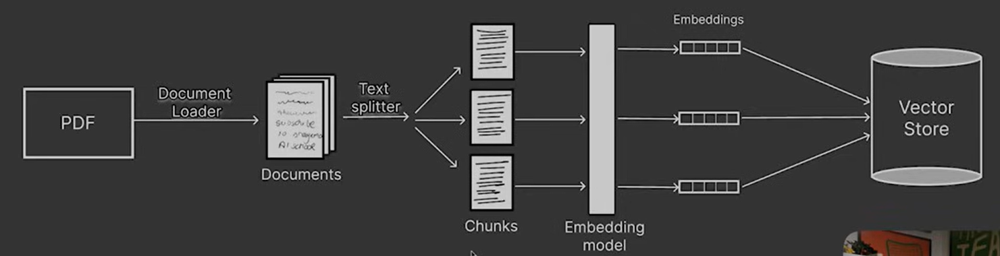
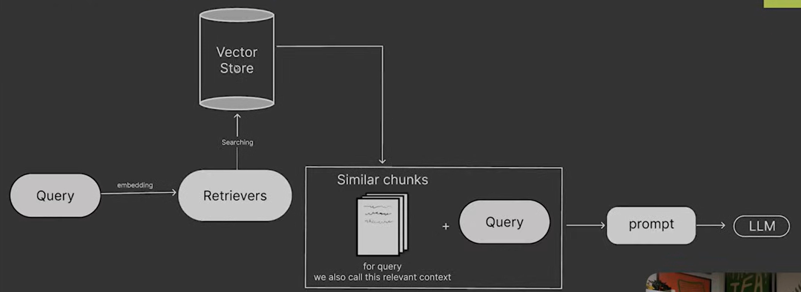

## What This Project Teaches

This project is a hands-on GenAI + RAG repository. The idea is simple:

1. Load data
2. Split into chunks
3. Convert text into vectors
4. Store vectors in a database
5. Retrieve relevant chunks
6. Send them to an LLM
7. Generate the final answer

### 1. LLMs in this project

- Gemini is used in `chatmodels/chat_gemini.py` and `RAG_Project/main.py`
- Hugging Face is used in `chatmodels/chat_huggingface.py`
- Ollama is used in `chatmodels/chat_ollama_local_model.py`

Remember:
- different providers = different model backends
- the application logic stays similar
- the key change is the model integration layer

### 2. Prompting and chat memory

- `chatmodels/chatbot.py` shows how to create a chatbot with system instructions
- `chatmodels/chatbot_UI.py` adds a Streamlit UI
- Messages are stored in a list: system + user + AI
- Each new message is appended to the conversation history

Think of it as:

```text
System message -> defines behavior
Human message -> current user request
AI message -> previous reply
``` 

This gives the bot context during conversation.

### 3. Embeddings = meaning in numbers

Embeddings convert text into vectors.

Examples:
- `embeddingmodels/gemini_embeddings.py`
- `embeddingmodels/huggingface_embedding.py`

Use cases:
- `embed_query()` for one text
- `embed_documents()` for many texts

Why it matters:
- similar text gets similar vectors
- vector distance tells us relevance

### 4. Document loaders

The project loads data from different places:

- PDF: `RAG_Project/document_loaders/pdf.py`
- text file: `RAG_Project/document_loaders/test.py`
- webpage: `RAG_Project/document_loaders/Web_page.py`
- Arxiv papers: `RAG_Project/retrievers/arixv.py`

Main idea:
- raw documents are the source material
- without data, retriever and LLM cannot answer correctly

### 5. Chunking

After loading documents, we split them into smaller pieces.

Why?
- LLM context is limited
- small chunks are easier to retrieve
- retrieval quality improves

Common tools:
- `RecursiveCharacterTextSplitter`
- `CharacterTextSplitter`

### 6. Vector database (Chroma)

Chroma stores embeddings and enables semantic search.

Key patterns:
- `Chroma.from_documents(...)` creates DB from documents
- `persist_directory` saves DB locally
- `vectorstore.as_retriever()` builds retrieval logic

Think of this as the system memory.

### 7. Retrieval strategies

This is the heart of RAG.

#### Similarity Search
- compares query vector with document vectors
- uses cosine similarity / dot product / euclidean distance
- returns top-k most similar chunks

#### MMR (Max Marginal Relevance)
- balances relevance + diversity
- avoids returning many near-duplicate docs
- better when you want different but relevant documents

#### MultiQuery
- generates multiple versions of the same question
- searches each query
- combines results from all searches
- improves recall when the query is ambiguous

### 8. End-to-end RAG flow

```text
Document -> Chunk -> Embed -> Store -> Retrieve -> Prompt -> LLM -> Answer
```

This is exactly what `RAG_Project/main.py` and `RAG_Project/app.py` are doing.

### 9. Retrieval + prompting

After retrieval:
- relevant chunks are joined into context
- the prompt becomes:
  - system instruction
  - retrieved context
  - user question

Then the LLM answers using the provided context only.

This is the core RAG pattern:

```text
User question
  ↓
Retriever finds relevant context
  ↓
LLM answers using context
```

### 10. Structured output with Pydantic

Files:
- `structured_output/movie_extractor.py`
- `structured_output/movie_extractor_UI.py`

Concept:
- unstructured text -> structured JSON-like data
- define a schema with `BaseModel`
- use `PydanticOutputParser`
- tell the LLM exactly what format to return

Example fields:
- title
- release_year
- genre
- director
- cast
- rating
- summary

This is useful for extraction tasks and clean data generation.

### 11. What to remember for interviews / revision

If someone asks: "What is RAG?"

Answer:
- RAG = Retrieval Augmented Generation
- first retrieve relevant docs from a vector database
- then use an LLM to generate answer grounded in that context

If someone asks: "What is a retriever?"

Answer:
- a retriever takes a query and returns the most relevant chunks/documents

If someone asks: "What is similarity search?"

Answer:
- compare query embedding to document embeddings
- use cosine similarity, dot product, or euclidean distance
- return top-k relevant results

If someone asks: "What is MMR?"

Answer:
- choose relevant but diverse documents, not just the most similar ones

If someone asks: "What is MultiQuery?"

Answer:
- generate multiple question versions and search for each version

### 12. One-line summary

This repo teaches how to build a practical AI application where documents are stored as embeddings, retrieved semantically, and passed into an LLM to answer questions with context.

---

### Final memory map

```text
Data source -> Loader -> Chunker -> Embedding -> Vector DB -> Retriever -> LLM -> Answer
```

This is the full story of the project.

### 13. Tool calling and function-calling with LLMs

Newer files in this project show how an LLM can call external tools dynamically instead of only generating text.

Files:
- `Tools/owntool.py`
- `Tools/calculator_tool.py`
- `Tools/toolcalling.py`
- `Tools/newssummarizer_builtin_tool.py`

Notes:
- A tool is a Python function wrapped with `@tool` and exposed to the model.
- Each tool should have a clear name, typed input, and a helpful docstring.
- The model decides when to call a tool based on the user request.
- The tool result is sent back into the model context for the next reasoning step.

Examples from this repo:
- calculator for math queries
- text length checker
- weather lookup
- Tavily-based news search
- summarization using a built-in search tool

This is the foundation of LLM-powered agents and tool-using assistants.

### 14. Runnable composition patterns

Files:
- `Runnables/runnablepassthrough.py`
- `Runnables/parallelrunnable.py`
- `Runnables/sequencerunnable.py`

Notes:
- `RunnablePassthrough` passes the incoming input unchanged to the next stage.
- `RunnableParallel` runs multiple branches at the same time and combines outputs.
- `RunnableLambda` lets you transform values before sending them to prompts or models.
- Chaining components with `|` creates a clean pipeline.

Common pipeline pattern:

```python
prompt | model | parser
```

This is useful for:
- multi-step reasoning
- parallel prompt execution
- combining code generation with explanation
- building reusable LangChain chains

### 15. Agentic workflows

Files:
- `agent.py`
- `Tools/toolcalling.py`

Notes:
- An agent is more than a normal chat model: it can decide to call tools.
- `create_agent(...)` is used to build an agent with a toolkit and instructions.
- Middleware can enforce safeguards like user approval before a tool call.
- Agents are useful when the task needs external data, calculations, or search.

Example in this repo:
- a city assistant that can fetch weather and news
- a human approval step before each tool call

This is a practical example of agentic AI using LangChain tools.

### 16. Direct vector DB examples and local RAG setup

Files:
- `RAG_Project/vector_store/DB.py`
- `RAG_Project/overall_flow.py`

Notes:
- These files show the vector store setup without a full app wrapper.
- `Chroma.from_documents(...)` creates a local vector database from document chunks.
- `persist_directory` saves the database to disk for reuse.
- `similarity_search()` is used to retrieve relevant chunks.
- `as_retriever()` turns the DB into a reusable retrieval component.

This is a clean local example of how embedding + retrieval works behind a full RAG project.

# Retrievers

A retriever takes a user query and returns the most relevant documents or chunks from a database.

Now there are 2 types of retriever:
1. by data source (Wikipedia, Arxiv, PubMed, etc.)
2. by retrieval strategy (Similarity, MMR, MultiQuery, etc.)

## Search Strategies - Similarity Search

The system compares the query vector with document vectors using similarity metrics like:
- Cosine similarity (most common)
- Dot product
- Euclidean distance

The retriever finds the most similar vectors.

Top-K documents are retrieved.



## MMR

MMR stands for:
Max Marginal Relevance

Its goal is to balance two things:
1. Relevance to the query
2. Diversity among retrieved documents

So instead of retrieving similar documents, it retrieves different but relevant documents.

## Search Strategies - MultiQuery

Imagine you built a RAG system for machine learning notes.

Your database contains these chunks:

Chunk 1: Gradient descent is an optimization algorithm used to minimize loss functions.
Chunk 2: Neural networks are trained using optimization algorithms like gradient descent.
Chunk 3: Weight updates in machine learning models are done using gradient descent.
Chunk 4: Support Vector Machines are supervised learning algorithms.

So instead of using one query, it generates multiple variations of the query using an LLM. So now the pipeline becomes:

User Query
↓
LLM generates multiple queries
↓
Retriever searches for each query
↓
Combine all retrieved documents



---

